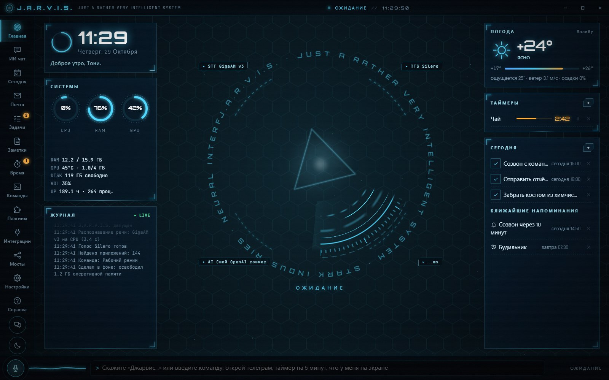
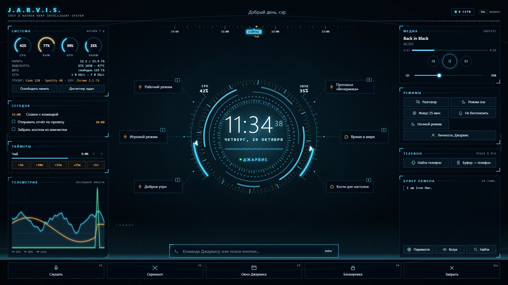
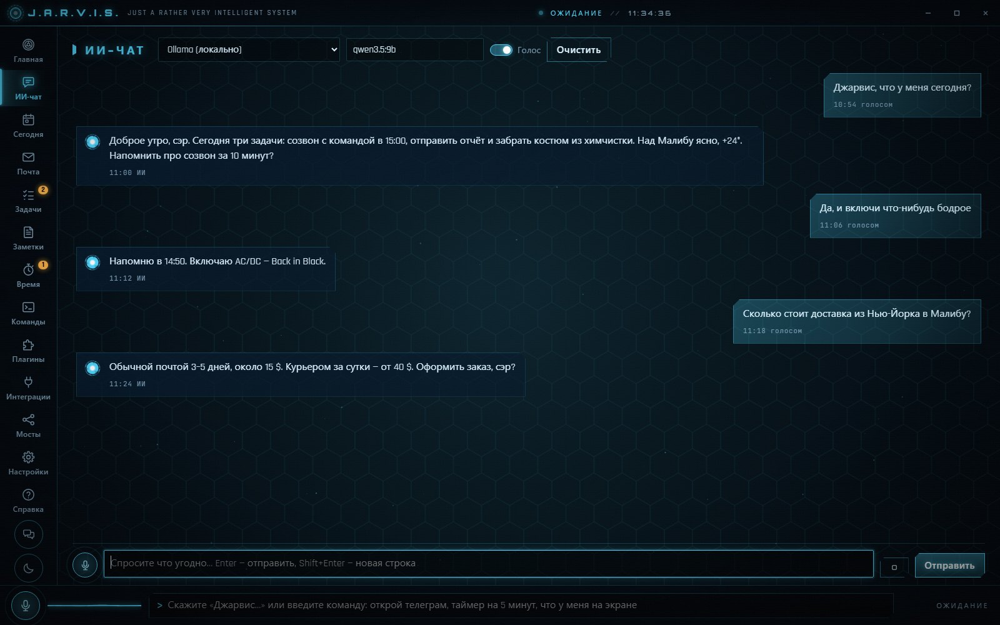
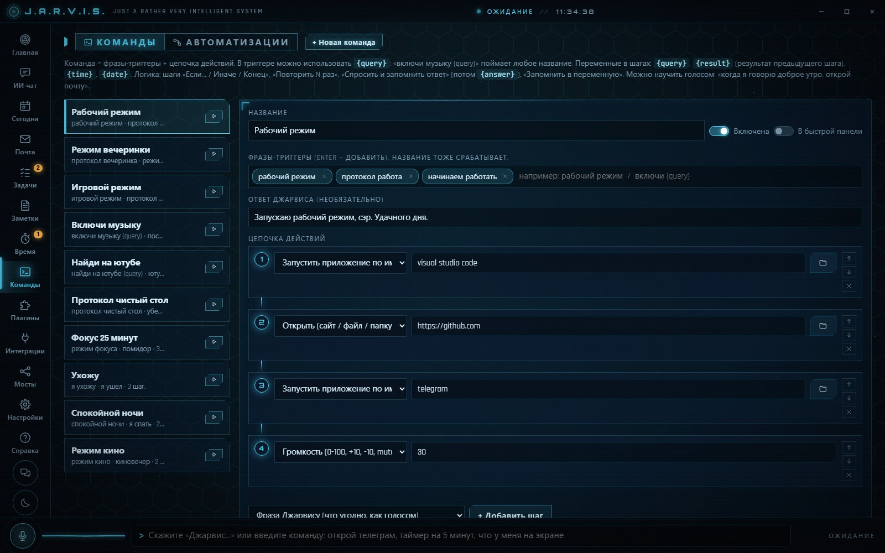
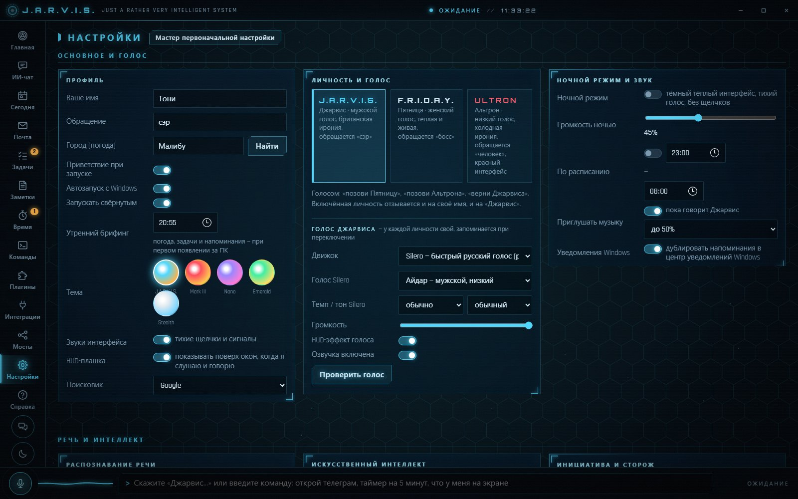

# J.A.R.V.I.S. — голосовой ассистент для Windows

Голосовой помощник в духе Железного человека: слушает в фоне фразы, начинающиеся с «Джарвис», понимает
русскую речь прямо на ПК, отвечает голосом, управляет компьютером и делами. Работает без интернета и без
платных ключей: распознавание речи, голос и даже ИИ (через Ollama) могут жить целиком на вашем компьютере.

| Быстрая панель (Ctrl+Alt+Q) — HUD поверх любой программы | ИИ-чат |
|---|---|
|  |  |
| **Свои команды — цепочки действий на фразу** | **Настройки, личности: Джарвис, Пятница, Альтрон** |
|  |  |

> Это не вирус — проверьте сами: [VirusTotal, 0 из 66 антивирусов](https://www.virustotal.com/gui/file/808cef82cf41d56676e9478b201245b8aee490217969a381843847a6e7f8472e),
> весь код открыт, ни одного `.exe`. Подробно — в разделе [«Безопасность»](#безопасность-это-не-вирус).

## Что умеет

- **Голос.** Фоновое слово-активатор, быстрое локальное распознавание (GigaAM, CPU), локальный голос (Silero),
  режим разговора без имени, диктовка, перебивание на полуслове.
- **Компьютер.** Программы, окна, громкость, медиа, поиск файлов, горячие клавиши, клики по надписям на экране,
  «что у меня на экране», выключение по таймеру и «выключи, когда досмотрю».
- **Сам делает и помнит.** «Сделай за меня: …» — ИИ выполняет задачу в программах по шагам, показывая маркером, куда
  нажимает. Макросы показом: «запиши макрос» → действия → название. Память экрана: «где я видел ту ссылку?»
  (распознавание на ПК). Маркер: «обведи кнопку Отправить». Подсказки по игре по скриншоту.
- **Дела.** Задачи, напоминания, будильники, таймеры, привычки, режим фокуса, вкладка «Заметки», почта (IMAP/SMTP),
  сообщения в Telegram / Discord / WhatsApp.
- **Свои команды.** Цепочки шагов с условиями («если… иначе»), повторами, вопросами и переменными. Новую команду
  можно продиктовать: «когда я говорю доброе утро, открой почту и скажи погоду».
- **Автоматизации.** Срабатывают сами: запустилась игра, отключили зарядку, подключили наушники или флешку,
  наступило время, вы отошли от ПК, появился файл в папке.
- **Плагины на Python** с редактором, разрешениями (интернет, клавиатура, файлы) и импортом/экспортом одним файлом.
- **Загрузка костюма.** При включении ПК — полноэкранная заставка: проверка систем этого компьютера, погода, дела
  и приветствие голосом. Без запросов к ИИ; по фразе «протокол загрузки» в любой момент.
- **Личности.** Джарвис, Пятница (женский голос, «босс») и Альтрон (низкий голос, холодная ирония, красный HUD).
- **Телефон (Android, KDE Connect).** Голосом говорит, кто звонит, и по правилам озвучивает уведомления
  (мессенджеры — «прочитать?», реклама отсеивается), «найди телефон», ссылки и буфер на телефон, звонок и SMS.
- **Обслуживание.** Сторож ПК (автозагрузка, неподписанные программы, майнеры), обновление программ через winget,
  разбор «Загрузок», резервные копии раз в неделю, обновление самого Джарвиса по кнопке.
- **Мосты к агентам**: Claude Code, Codex, Antigravity, Gemini CLI — «Джарвис, поручи Кодексу…».

## Установка

1. Установите **Python 3.12** с [python.org](https://www.python.org/downloads/) — при установке отметьте
   «Add python.exe to PATH». Python из Microsoft Store не подходит: Windows не даёт ему микрофон.
2. Скачайте проект (кнопка **Code → Download ZIP** или `git clone`) и распакуйте в папку без особых прав,
   например `Документы\jarvis`.
3. Запустите **`install.bat`**. Он поставит библиотеки и скачает модели речи (~300 МБ). Видеокарта не нужна.
4. Запустите **`Jarvis.bat`**. При первом запуске откроется мастер: имя, голос, микрофон, ИИ.
5. Скажите: «Джарвис, открой ютуб».

`Jarvis-debug.bat` — запуск с консолью, если что-то пошло не так. Закрытие окна сворачивает Джарвиса в трей:
он продолжает слушать. Окно — клик по иконке у часов или `Ctrl+Alt+Space`.

Необязательно: `install_xtts.bat` — экспериментальный клон голоса (нужна видеокарта NVIDIA).

## ИИ: любой на выбор

Команды компьютера, таймеры, заметки и прочее работают и без ИИ. ИИ нужен для свободного разговора и сложных просьб.

| Вариант | Что нужно |
|---|---|
| **Ollama — локально, бесплатно** (по умолчанию) | ничего: в мастере или в Настройки → ИИ кнопка «Бесплатный локальный ИИ в один клик» сама ставит Ollama и модель под вашу видеокарту |
| LM Studio, llama.cpp, Jan, KoboldCpp | свой локальный сервер |
| Бесплатные ключи: Groq, Google Gemini, OpenRouter | ключ с сайта сервиса |
| OpenAI, Anthropic, DeepSeek, Mistral, xAI, YandexGPT… | платный ключ |
| Любой OpenAI-совместимый сервер | адрес и ключ |
| Мосты: Claude CLI, Codex CLI, Gemini CLI, Antigravity | установленный агент; даёт поиск в интернете и «зрение» |

Провайдер меняется в любой момент: Настройки → Искусственный интеллект.

## Телефон (необязательно)

Нужен [KDE Connect](https://kdeconnect.kde.org/) на ПК (Настройки → Телефон → «Установить») и на Android-телефоне,
обе в одной Wi-Fi. Всё идёт по локальной сети, без облака. Если телефон не видит ПК (часто из-за VPN вроде
Radmin или WireGuard), там же есть подключение по IP. Номера для «позвони маме» и SMS задаются в той же панели.

## Приватность

Всё личное хранится только в папке `data/` рядом с программой: настройки (с ключами ИИ и паролями почты), чат,
задачи, заметки, плагины. Эта папка не попадает в репозиторий (`.gitignore`) и в сборку для друзей
(`pack_for_friend.py`). Голос и речь обрабатываются на ПК; в интернет уходит только то, что вы сами
отправляете выбранному облачному ИИ.

## Безопасность: это не вирус

Голосовой ассистент по своей природе слушает микрофон, видит экран и нажимает кнопки — поэтому осторожность
понятна. Вот как это проверить самому, а не верить на слово:

- **Весь код открыт.** Только Python и JavaScript, ни одного `.exe`, `.dll` или запутанного кода: любой файл можно
  открыть в Блокноте и прочитать.
- **Проверка 66 антивирусами.** Архив релиза v2026.10.28.2059 (`jarvis_share.zip`, SHA-256
  `808cef82cf41d56676e9478b201245b8aee490217969a381843847a6e7f8472e`) на VirusTotal:
  [0 из 66 — «No security vendors flagged this file as malicious»](https://www.virustotal.com/gui/file/808cef82cf41d56676e9478b201245b8aee490217969a381843847a6e7f8472e).
  Ссылка на скачивание из релизов: [0 из 93](https://www.virustotal.com/gui/url/5eb1ab1a4d7c3448435aacb53307ef982c6e5165a5fc2159bbe5cf616b1fca70).
- **Что делает `install.bat`.** Он только запускает `install.ps1` (его тоже можно прочитать), а тот:
  1. снимает с распакованных файлов метку «скачано из интернета»;
  2. если Python нет — ставит Python 3.12 с python.org (или через winget);
  3. создаёт папку `.venv` рядом с программой и ставит туда пакеты из `requirements.txt` (с PyPI) и PyTorch
     (с download.pytorch.org);
  4. скачивает модели распознавания речи и голоса (около 300 МБ);
  5. создаёт ярлык на рабочем столе.

  Прав администратора не нужно; служб, драйверов и изменений в системе нет. Удалить Джарвиса — удалить папку.

**Почему антивирус или человек может насторожиться — и что это на самом деле:**

| Что делает | Зачем |
|---|---|
| Постоянно слушает микрофон | Ждёт слово «Джарвис». Речь распознаётся на вашем ПК, звук никуда не отправляется |
| Видит экран | Только по команде: «что у меня на экране», клики по надписям, маркер «обведи кнопку…» |
| Нажимает клавиши и двигает мышь | Только когда вы просите: «напечатай…», «нажми на Отправить» |
| Глобальные горячие клавиши | Ctrl+Alt+J — слушать, Ctrl+Alt+Space — окно, Ctrl+Alt+Q — быстрая панель |
| Видит список процессов | Сторож ПК замечает майнеры и зависания; закрывает программу только после вашего «да» |
| Память экрана | Раз в минуту запоминает текст активного окна — только в папке `data/` на вашем ПК, без интернета и ИИ, хранится 7 дней. Пропускает менеджеры паролей, банки и приватные окна; «не запоминай экран» выключает, «забудь экран» стирает |
| Записывает клики и клавиши | Только во время «запиши макрос» и только до «стоп запись» |
| Блокирует ПК | Если включено «ушёл — вернулся»: телефон ушёл из Wi-Fi, а за ПК никого |
| Сам обновляется | Только по кнопке в настройках и только из релизов этого репозитория |
| Автозапуск с Windows | Только если включить его в настройках |

**Сеть.** Наружу уходит только то, что нужно для команды: вопрос выбранному ИИ (с Ollama — ничего, всё локально),
поиск, погода (open-meteo.com), проверка обновлений на GitHub. Телефон подключается через KDE Connect только по
вашей домашней Wi-Fi.

## Для разработчиков

| Часть | Файл |
|---|---|
| Распознавание речи: GigaAM v3 (CPU) или faster-whisper, VAD, слово-активатор, фильтр эха | `jarvis/stt.py` |
| Голос: Silero, Edge Neural, ElevenLabs, XTTS, SAPI; кэш фраз | `jarvis/tts.py` |
| Голосовые правила (~100 фраз) и понимание формулировок | `jarvis/intents.py`, `jarvis/skills.py`, `jarvis/nlu.py` |
| Управление ПК, мышь, экран | `jarvis/system.py`, `jarvis/mouse.py` |
| Команды, логика шагов, интеграции; обучение голосом | `jarvis/commands.py`, `jarvis/teach.py` |
| Автоматизации | `jarvis/automation.py` |
| Плагины и их разрешения | `jarvis/plugins.py`, `jarvis/plugin_host.py` |
| ИИ-провайдеры, мосты к агентам, MCP-сервер | `jarvis/llm.py`, `jarvis/bridges.py`, `jarvis/mcp_server.py` |
| Личности (Джарвис, Пятница, Альтрон) | `jarvis/persona.py` |
| Телефон через KDE Connect (D-Bus) | `jarvis/phone.py` |
| Заметки, резервные копии, фоновые задачи, слежка | `jarvis/notes.py`, `jarvis/backup.py`, `jarvis/background.py`, `jarvis/watchers.py` |
| Сторож ПК и инициатива | `jarvis/sentinel.py` |
| Интерфейс (HUD) | `ui/` |

Локальный API: `POST http://127.0.0.1:8770/api/rpc` с заголовком `X-Jarvis-Token` (из `data/config.json`),
тело `{"method": "say", "params": {"text": "Привет"}}`. Из консоли: `python tools/jrpc.py say '{"text":"Привет"}'`.

Свои обновления для друзей: `python tools/publish_update.py "что нового"` (нужен GitHub CLI); канал обновлений
задаётся в `jarvis/config.py` → `update.github`.

## Авторы

- [komar-hubs](https://github.com/komar-hubs)
- [KotikVanil](https://github.com/KotikVanil)
- Claude (Anthropic) — помощь в разработке

Код — под лицензией [MIT](LICENSE).

## Лицензии моделей

- GigaAM v3 (Сбер): MIT.
- Silero TTS: CC BY-NC-SA 4.0 — только личное некоммерческое использование.
- XTTS v2: Coqui Public Model License (некоммерческая).
